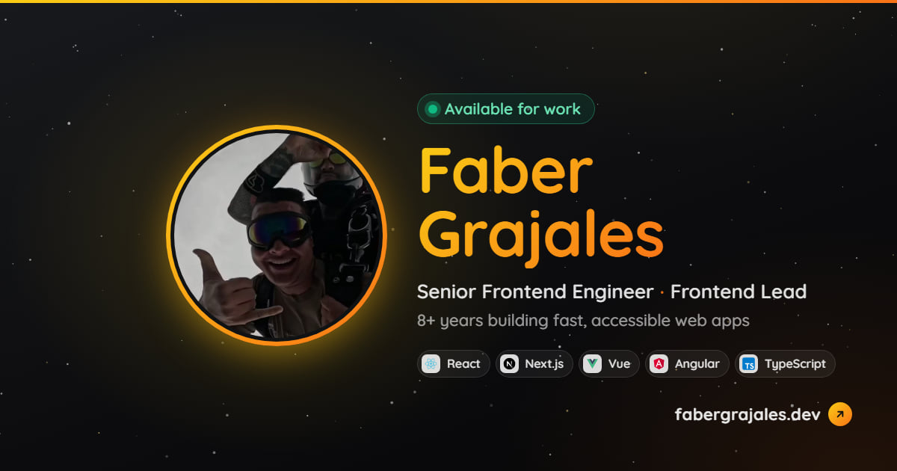

<div align="center">

# Faber Grajales

**Frontend Development Lead · Senior Frontend Engineer**

Systems Engineer building scalable web applications for enterprise B2B clients since 2018.

[](https://fabergrajales.dev/)
[](https://www.linkedin.com/in/faber1999/)
[](https://github.com/faber1999)

[](https://fabergrajales.dev/)

**[Visit the portfolio](https://fabergrajales.dev/)** · **[Download CV (EN)](https://fabergrajales.dev/cv/Faber-Grajales-CV-en.pdf)** · **[Descargar CV (ES)](https://fabergrajales.dev/cv/Faber-Grajales-CV-es.pdf)**

</div>

---

## About me

I'm a Systems Engineer specializing in **frontend development, architecture and technical leadership**. Since 2018 I have shipped web applications for enterprise B2B clients, from SQL-heavy business systems to modern React/Next.js storefronts.

I have led frontend architecture standards and modernization efforts, integrated Node.js and .NET APIs, and I use AI-assisted workflows to take Figma designs to production.

- **Location:** Armenia (Quindío), Colombia · GMT-5
- **Languages:** Spanish (native) · English (B2, EF SET certified)
- **Availability:** Open to full-time roles · remote work · relocation

## Core skills

| Area | Technologies |
| --- | --- |
| **Frontend** | React, Next.js, Vue.js, Angular, TypeScript, JavaScript, Tailwind CSS |
| **State & data** | Zustand, TanStack Query, GraphQL |
| **Backend & data** | SQL Server, Node.js, NestJS, C# / .NET, Supabase |
| **Tooling** | Git, Jenkins, n8n, Figma, Jira, AI-assisted development (Cursor, Claude Code) |

Strongest areas: **React** and **SQL Server** (expert), **Next.js, Vue.js, Angular, TypeScript** (advanced).

## Experience highlights

**Senior Frontend Developer (Contractor)** · Smith · _Apr 2026 – Oct 2026_
Built the storefront of a B2B wholesale e-commerce platform for the U.S. and Canada (Next.js 15, React 19, TypeScript, BFF over Azure Functions, Contentstack CMS): product, cart, checkout, account, saved lists and order details.

**Frontend Development Lead** · Celuweb.com S.A.S. · _Mar 2022 – Nov 2025_
Defined frontend architecture standards and led technical decisions, migrations and code reviews. Built a drag-and-drop survey generator and a dynamic ECharts reporting system on React, Next.js and .NET Core.

**Solutions Consultant III** · Sophos Solutions · _May 2021 – Mar 2022_
Built a full-stack credit eligibility system for Banco Popular with Angular, .NET Core and SQL Server.

**Web Application Developer** · Celuweb.com S.A.S. · _Jun 2018 – Apr 2021_
Delivered enterprise B2B applications for brands such as Postobón, Nutresa, Ramo and Alquería, migrating .NET WebForms apps to Vue.js and React.

Full timeline: [fabergrajales.dev/experience](https://fabergrajales.dev/experience)

## Featured projects

| Project | Description | Links |
| --- | --- | --- |
| **F.W. Webb** | B2B wholesale e-commerce platform (in development at Smith). Frontend for product, cart, checkout, account, saved lists and order details. | [Demo](https://ecomm-application-mobile-one.vercel.app/) |
| **DSD** | Dynamic platform for commercial roles (self-sale, pre-sale, deliveries, marketing). I led the frontend team and set up a Clean Architecture in React. | Private |
| **Axon.js** | A lightweight JavaScript framework I built from scratch with fine-grained reactivity (signals), JSX, a router and a store, with zero dependencies. | [Docs](https://axon-docs.fabergrajales.dev) · [GitHub](https://github.com/faber1999/axon.js) |

More details and screenshots: [fabergrajales.dev/projects](https://fabergrajales.dev/projects)

## Education

- **Systems Engineering** (2022). Worked full-time by day and studied at night to graduate.
- **Technologist in Analysis and Development of Information Systems**, SENA (2019). Represented Quindío at the national SenaSoft 2017 web development competition.
- **Certifications:** Certified Mid-Level Vue.js Developer (certificates.dev), EF SET English B2, Scrum Master Professional Certificate, DevOps Essentials, plus courses in Angular, TypeScript and Zustand.

## Contact

- **Email:** [fabergrajales1999@gmail.com](mailto:fabergrajales1999@gmail.com)
- **LinkedIn:** [in/faber1999](https://www.linkedin.com/in/faber1999/)
- **GitHub:** [faber1999](https://github.com/faber1999)
- **Portfolio:** [contact details on the home page](https://fabergrajales.dev/)
- **CV:** [English (PDF)](https://fabergrajales.dev/cv/Faber-Grajales-CV-en.pdf) · [Español (PDF)](https://fabergrajales.dev/cv/Faber-Grajales-CV-es.pdf)

<details>
<summary><strong>Leer en español</strong></summary>

### Faber Grajales: Líder de Desarrollo Frontend · Ingeniero Frontend Senior

Soy Ingeniero de Sistemas y desde 2018 construyo aplicaciones web escalables para clientes empresariales B2B. Me especializo en **desarrollo frontend, arquitectura y liderazgo técnico**. He liderado estándares de arquitectura y modernización frontend, integrando APIs en Node.js y .NET, y uso flujos asistidos por IA para llevar diseños de Figma a producción.

- **Ubicación:** Armenia (Quindío), Colombia · GMT-5
- **Idiomas:** español (nativo) · inglés (B2)
- **Disponibilidad:** tiempo completo · trabajo remoto · reubicación
- **Stack principal:** React, Next.js, Vue.js, Angular, TypeScript, Tailwind CSS, Zustand, TanStack Query, SQL Server, .NET
- **Experiencia reciente:** Smith (Senior Frontend, e-commerce B2B), Celuweb.com (Líder de Desarrollo Frontend), Sophos Solutions (Consultor de Soluciones III)
- **Proyectos:** F.W. Webb (e-commerce B2B), DSD (plataforma comercial, privada) y [Axon.js](https://github.com/faber1999/axon.js) (framework reactivo propio)

**[Ver el portafolio](https://fabergrajales.dev/)** · **[Descargar CV en español](https://fabergrajales.dev/cv/Faber-Grajales-CV-es.pdf)** · **[Contacto](https://fabergrajales.dev/)**

</details>

---

## About this site

This repository is the source of [fabergrajales.dev](https://fabergrajales.dev/), built with the same care I bring to production work:

- **Vue 3 + TypeScript + Vite**, with Vue Router and shareable deep links (e.g. `/projects?project=axon`)
- **Tailwind CSS** with light and dark themes
- **Bilingual (EN/ES)** content via `vue-i18n`
- **Accessibility first:** semantic landmarks, screen-reader labels, reduced-motion support
- **SEO & social previews:** canonical URL, Open Graph and Twitter cards, optimized AVIF/WebP assets
- **CI/CD:** GitHub Actions builds with pnpm and deploys to Hostinger on pushes to `main`

```bash
pnpm install
pnpm dev
```
